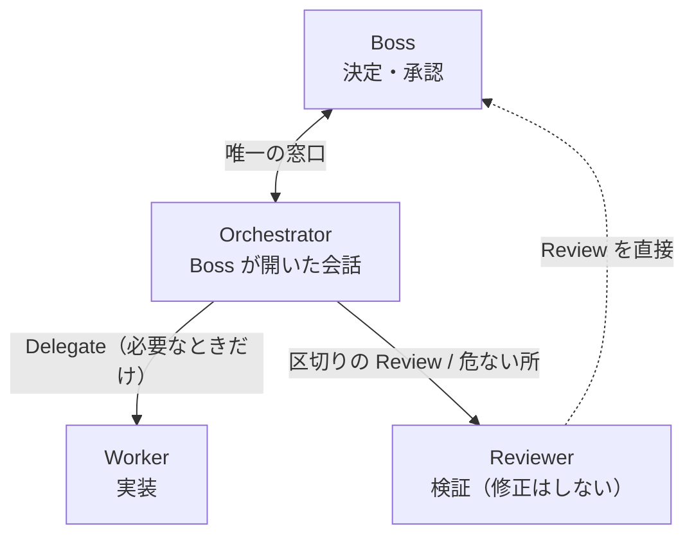
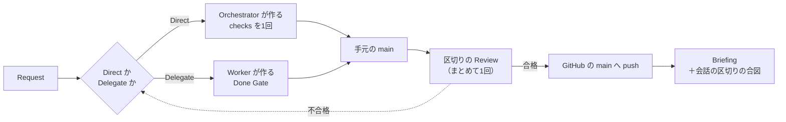
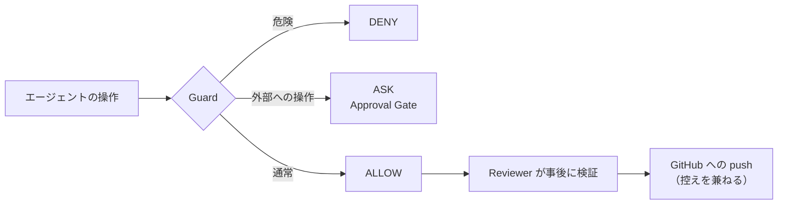
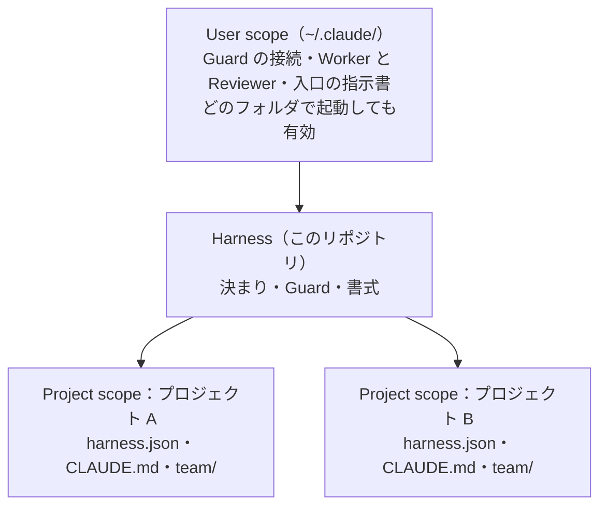
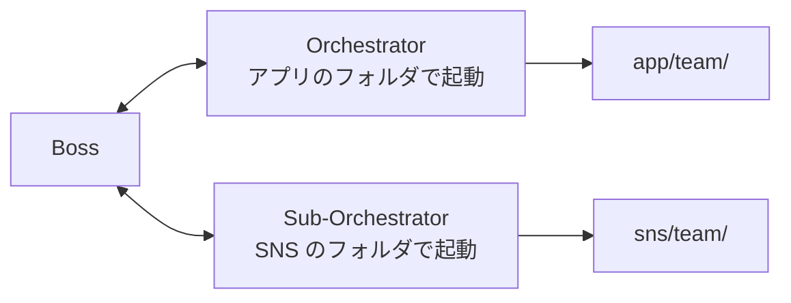

# ai-team-harness

> 一人の開発者が、Claude Code の AI エージェントを「チーム」として安全に動かすための運用基盤です。
> 作者が毎日の開発で使っている Harness から、個人の情報と運用中のプロジェクトの記録を外して公開しています。

**English summary**: A personal operating harness for running Claude Code agents as a small team — one human "Boss", an Orchestrator conversation, Worker/Reviewer subagents, and a PreToolUse hook ("Guard") that denies dangerous operations and asks only for 7 kinds of truly risky external actions. Docs are in Japanese.

## このリポジトリの読み方

| 知りたいこと | 読むところ |
|---|---|
| 全体の設計（役・流れ・守り） | このページの下の本文 |
| Orchestrator が毎回読む「地図」 | [CLAUDE.md](CLAUDE.md) |
| 何を止め、何を聞き、何を任せるか | [rules/permissions.md](rules/permissions.md)・[rules/defense.md](rules/defense.md) |
| 止める・聞くを決めるプログラム | [hooks/guard.mjs](hooks/guard.mjs)（テスト：`node --test hooks/*.test.mjs`） |
| なぜこの形にしたか（実際に運用して測った結果つき） | [decisions/](decisions/) |

**注意**：作者の環境（Windows・Git Bash・VS Code）で毎日使うために作ったものです。そのまま使える汎用の道具ではなく、設計の一例として読んでいただくことを想定しています。公開版は作業用のリポジトリから、区切りごとに1コミットで写しています。

---

## Harness の全体像

**Harness は、一人の開発者が Claude Code の AI エージェントを「チーム」として安全に運用するための基盤です。**

最終決定者である **Boss**（開発者）の指示を、**Orchestrator** が Task に分解し、**Worker** が実装し、**Reviewer** が独立して検証します。基本はすべて許可して止まらずに進め、危険な操作は **Guard** が実行の直前で遮断し、本当に危ない外部への操作（お金・本番・公開・SNS・鍵・外への送信）だけが **Approval Gate**（Boss の承認）を通ります。

---

## 目次

1. [背景](#1-背景)
2. [設計原則](#2-設計原則)
3. [Claude Code と Harness の分担](#3-claude-code-と-harness-の分担)
4. [ロール](#4-ロール)
5. [ワークフロー](#5-ワークフロー)
6. [Defense in Depth](#6-defense-in-depth)
7. [Scope と記録](#7-scope-と記録)
8. [並行運用](#8-並行運用)
9. [日々の使い方](#9-日々の使い方)
10. [導入](#10-導入)
11. [リポジトリ構成](#11-リポジトリ構成)
12. [用語集](#12-用語集)

---

## 1. 背景

AI エージェント1つと1対1で開発すると、次の問題が起きます。Harness は、それぞれに仕組みで答えます。

| 問題 | Harness の答え |
|---|---|
| 指示と違う実装をされても、全部を読まないと気づけない | 実装する Worker とは別に、検証専門の **Reviewer** を置く |
| 実装したエージェント自身に聞くと、ほぼ「完了」と答える | Review は作る側を通さず、**Boss が直接読む** |
| 会話が長くなると、以前の決定が失われる | 決定（ADR）と現在の状況（Status）を**ファイルに残し**、次の会話が続きから始める |
| 誤った削除や意図しない公開が怖く、任せきれない | **Guard** が危険な操作を遮断し、外部へ出る操作は **Approval Gate** を通す |

## 2. 設計原則

### 三原則（2026-11-09）

Harness を直すときは、いつもこの3つを基準にします。ぶつかるところは Boss に相談して決めます（[decisions/2026-11-09-three-principles.md](decisions/2026-11-09-three-principles.md)）。

| # | 原則 | Harness での形 |
|---|---|---|
| 1 | **Boss の関与を少なくする**。聞くときは1つずつ出さず、まとめる | 基本は全部許可。確認画面は本当に危ない 7 種類だけで、用件ごとに1回 |
| 2 | **トークンを効率よく使う** | 小さい作業は Orchestrator が直接作る。会話を長くしすぎない |
| 3 | **早く終える** | Worker・Reviewer は効くところだけに使う |

### そのほかの原則

1. **最終決定は Boss**：お金・本番・公開・投稿などの外部への操作は、Boss が Approval Gate で許可したときだけ実行します。
2. **階層は浅く**：中間の管理エージェントを置きません。受け渡しのたびに暗黙の判断が失われ、コストも増えるためです。
3. **Maker と Checker の分離**：実装したエージェントは自分の成果を甘く評価します。検証は独立した Reviewer が行います。
4. **状態はファイルに**：会話が切れても、記録を読めば再開できます。毎回読むのは、短い地図と Status だけです。
5. **Boss の負荷を計測する**：Boss への質問や修正依頼の回数を Boss Load に記録し、減少を追います。

## 3. Claude Code と Harness の分担

Harness は、**Claude Code がもともと持っている仕組み**の上に、**足りないところを自作して**載せています。どこまでが Claude Code の機能で、どこからが Harness の自作かは次のとおりです。

### Claude Code がもともと持っているもの（Harness は設定を書くだけ）

| 機能 | 何をするか | Harness での使い方（設定する場所） |
|---|---|---|
| **設定ファイル** `settings.json` | 道具ごとに許可（`allow`）・禁止（`deny`）・確認を決める | User scope に「基本は全部許可」と「秘密・強制 push などの禁止」を書く（[templates/user/settings.json](templates/user/settings.json)） |
| **確認画面** | 許可していない操作や、フックが「聞く」と答えた操作の前に、Boss に許可・拒否を聞く | Guard が「聞く」と答えたときだけ出るようにしている。これが **Approval Gate** |
| **フック**（PreToolUse・PostToolUse・Stop） | 道具を使う前・後や、エージェントが終わる前に、決めたプログラムを動かす | 前に Guard、後に Guard の記録係（`--post`）、Worker の終わりに Done Gate をつなぐ |
| **サブエージェント** `agents/*.md` | 別の会話を立てて仕事を任せる。道具や作業場所を絞れる | Worker と Reviewer を定義する（[agents/](agents/)） |
| **Worktree での分離**（`isolation: worktree`） | サブエージェントに、リポジトリの作業用の写しを自動で作る | Worker が本体を壊さずに実装する |
| **CLAUDE.md** | 会話の始めに必ず読む指示書 | Orchestrator の地図（[CLAUDE.md](CLAUDE.md)）と、各プロジェクトの入口 |

### Harness が自作して足したもの

| 自作のもの | 場所 | 何をするか |
|---|---|---|
| **Guard** | [hooks/guard.mjs](hooks/guard.mjs) | 道具を使う直前に、止める・聞く・通すを決める。役ごとの書き込み先、禁止のこと、Merge 前の Review の確認、まとめての許可 |
| **Done Gate** | [hooks/done-check.mjs](hooks/done-check.mjs) | Worker が終わる前に検査（型・テスト・lint）を流し、通ったコミットを記録する |
| **導入の確認・片付け** | [hooks/check-install.mjs](hooks/check-install.mjs)・[scripts/clean-worktrees.mjs](scripts/clean-worktrees.mjs) | 正しく入っているかの確認と、使い終わった Worktree の片付け |
| **決まり** | [rules/](rules/)・[departments/](departments/) | 何を止める・聞く・任せるか、部門ごとの進め方 |
| **記録の書式** | [templates/](templates/) | Request・Task・Review・Approval Record など |
| **プロジェクトの記録** | 各プロジェクトの `team/` | 状況・決定・Task・Review・ログ |

**目安**：設定ファイル・確認画面・フック・サブエージェントの「入れ物」は Claude Code のもの、その中で動く「判断」（何を止めて何を聞くか）は Harness のものです。Claude Code だけでは「本番への反映だけ聞く」「Review に合格したものしか Merge させない」といった細かい判断ができないので、Guard を自作しています。

## 4. ロール

| ロール | 実体 | 責任 |
|---|---|---|
| **Boss** | 開発者本人 | 決定する。Approval Gate で外部操作を許可する。Review を読む。実機で確認する |
| **Orchestrator** | Boss が開いた Claude Code の会話 | Request の整理、**Direct（直接作る）が標準**、必要なときだけ Delegate（Worker に渡す）、Reviewer の指揮、Merge、Briefing、会話の区切りの合図 |
| **Sub-Orchestrator** | 2つ目の会話（必要なときだけ） | 1つのプロジェクトを受け持ち、並行して進める |
| **Worker** | サブエージェント `worker` | 1つの Task を、専用の **Worktree**（リポジトリの写し）の中だけで実装する |
| **Reviewer** | サブエージェント `reviewer` | 工程の区切りにまとめて1回と、データ・課金・ログイン・サーバー・時刻に触れたときに、仕様と照らして正しさを確かめる |
| **Guard** | PreToolUse フック `hooks/guard.mjs` | 道具を使う直前に、DENY・ASK・ALLOW を判定する |

Worker と Reviewer は Task ごとに起動し、終わると消えます。SNS・動画など開発以外の作業も、当面は開発と同じ流れで進めます。

## 5. ワークフロー

三原則（関与を少なく・トークンを効率よく・早く）に合わせ、**Orchestrator が直接作るのを標準**にしています（2026-11-09。[decisions/2026-11-09-direct-first.md](decisions/2026-11-09-direct-first.md)）。

Worker は毎回ゼロから読み直すので、同じ仕事なら Direct の方が2〜4倍速いことが実際のプロジェクトで測って分かりました。どちらにするかの表は [CLAUDE.md](CLAUDE.md) の「分かれ目の表」、進め方の詳細は [departments/dev.md](departments/dev.md) にあります。

**会話の区切り**：会話が長いと応答のたびに全部を読み直し、トークンと時間が増えます。作業のまとまりが終わったときなどに、Orchestrator が STATUS を書いてから「新しい会話にしてください」と伝えます。

## 6. Defense in Depth

Windows ネイティブ環境では Claude Code のサンドボックスが動作しません。そのため、複数の層で防御します。

- **止める・聞く・通す**：危険な操作（一括削除・強制 push・秘密の読み取りなど）は Guard が止めます。本当に危ない外部への操作 7 種類だけを、Approval Gate（Claude Code の確認画面）で Boss に聞きます。聞くときは用件1つにつき1回です。ほかは確認なしで進めます。区分は [rules/permissions.md](rules/permissions.md)、Guard の判定は [rules/defense.md](rules/defense.md) にあります。
- Approval Gate は画面の確認です。エージェントがファイルに「承認済み」と書いても通過できません。
- Guard はコマンドを文字列として解析するため、すべての回避手段を防げるわけではありません。この限界を前提に、Done Gate と Reviewer を重ねています。
- Branch Protection と Backup は入れていません（2026-11-08 Boss の判断）。

## 7. Scope と記録

Claude Code が読む設定は、**起動したフォルダ**と **User scope**（`~/.claude/`）の2か所だけです。Harness はこれに合わせて3層で構成します。

- Harness にはプロジェクトの記録を置きません。そのため、このリポジトリはそのまま公開できます。
- プロジェクトの記録は、各プロジェクトの `team/` で完結します。

### User scope と Harness を分けている理由

| | User scope（`~/.claude/`） | Harness（このリポジトリ） |
|---|---|---|
| 置くもの | 設定（許可・禁止・フックのつなぎ）、Worker と Reviewer の定義の写し、入口の指示書 | Guard などのプログラム本体、決まり、書式、設定のひな形 |
| 効く範囲 | **この PC のどのフォルダで開いた会話にも効く** | それ自体は効かない。User scope から呼ばれて初めて動く |
| GitHub | 上げない（PC ごとのもの。ホームの住所などが入る） | 上げる（控え・ほかの PC への導入・公開） |

分けている理由は3つです。

1. **効く範囲**：Claude Code が読む設定は、会話を開いたフォルダ（Project scope）と User scope の2か所だけです。プロジェクトの設定に書いた許可や Guard は、そのフォルダで開いた会話にしか効きません。Harness の守りはどこで開いても効かせたいので、**つなぎ（設定）は User scope** に置きます。2026-11-09 までは許可をプロジェクトの設定に書いていたため、ほかのフォルダや Worker の作業場所の外では Claude Code 自身の確認画面が出つづけていました。
2. **中身の管理**：User scope は GitHub で管理しにくい場所です。**中身（Guard・決まり）は Harness のリポジトリ**に置いて履歴と控えを残し、User scope からはその住所を呼ぶだけにします。Guard を直せば、どのフォルダの会話にもすぐ効きます。
3. **公開と導入**：PC ごとの住所や個人の設定は User scope に閉じこめ、Harness はそのまま公開・別の PC に導入できる形を保ちます（[templates/user/](templates/user/) に、User scope に入れる設定のひな形があります）。

プロジェクトの `team/` に置く記録の一覧は、[rules/operations.md](rules/operations.md) の「記録」にあります。

## 8. 並行運用

通常は会話1つで運用します。Orchestrator が部門を持ち替え、Worker は最大3つまで並行して動きます。

開発と SNS などを並行して進める場合は、2つ目の会話で **Sub-Orchestrator** を立てます。

決まり（1つのプロジェクトを扱う会話は1つまで、など）は [CLAUDE.md](CLAUDE.md) の「並行運用」にあります。

## 9. 日々の使い方

1. VS Code で**作業するプロジェクトのフォルダ**を開き、Claude Code の会話を始めます
2. 最初に次のように伝えます
   > Harness で続きをお願いします。team/STATUS.md の「次にやること」から進めてください。
3. 以降は、自然な言葉で指示します

| 確認するもの | 場所 |
|---|---|
| 報告 | チャット（大きい依頼は `team/briefings/`） |
| 検証結果（Orchestrator を経由しない） | `team/reviews/` |
| 実機で確認する項目 | `team/device-qa.md` |

確認画面（Approval Gate）は、本当に危ない操作のときだけ、用件ごとに1回出ます。要約・理由・コマンドの一覧を確かめて、問題がなければ許可します。確認なしで進めた変更（決まりの文書・パッケージの追加など）は、作業の終わりにチャットでまとめて報告されます。

## 10. 導入

| 手順 | 内容 |
|---|---|
| 1 | このリポジトリを配置する |
| 2 | [templates/user/settings.json](templates/user/settings.json) を `~/.claude/settings.json` に統合する（`{{HARNESS}}` をこのリポジトリのパスに、`{{HOME}}` をホームのパス（`//c/Users/<名前>` の形）に置換） |
| 3 | [templates/user/CLAUDE.md](templates/user/CLAUDE.md) を `~/.claude/CLAUDE.md` に追加する |
| 4 | [agents/](agents/) の `worker.md`・`reviewer.md` を `~/.claude/agents/` に配置する（`{{HARNESS}}` を置換） |
| 5 | [templates/projects.md](templates/projects.md) を `projects.md`（プロジェクトの台帳。git に入れない）として写し、手順に沿ってプロジェクトに `.claude/harness.json` と `team/` を用意する |
| 6 | このフォルダで `node hooks/check-install.mjs` を実行し、すべて ✔ であることを確認して、Claude Code を再起動する |

**要件**：Claude Code v2.1.295 以上、Node.js、Git Bash

## 11. リポジトリ構成

| パス | 内容 |
|---|---|
| [CLAUDE.md](CLAUDE.md) | Orchestrator の地図（会話の開始時に読む） |
| [departments/](departments/) | 進め方（開発。開発以外の作業も当面これを使う） |
| [rules/](rules/) | 決まり（権限の4区分・Approve 区分・Deny 区分・Defense in Depth・上限・運用） |
| [agents/](agents/) | Worker と Reviewer の定義 |
| [hooks/](hooks/) | Guard・Done Gate・導入確認・テスト（`node --test hooks/*.test.mjs`） |
| [templates/](templates/) | 記録の書式と、配置するファイルのひな形 |
| [decisions/](decisions/) | Harness そのものの ADR |
| [ROADMAP.md](ROADMAP.md) | 完了したことと、次に検討すること |

## 12. 用語集

| 用語 | 意味 |
|---|---|
| **Boss** | 最終決定者である開発者 |
| **Orchestrator / Sub-Orchestrator** | Boss と対話し、チームを指揮する会話 |
| **Worker / Reviewer** | 実装するエージェント / 検証するエージェント |
| **Guard** | 道具の使用を直前に判定するフック |
| **Approval Gate** | 外部へ出る操作に対する Boss の承認（Claude Code の確認画面） |
| **Done Gate** | Worker の終了前に検査を強制する仕組み |
| **区切りの Review** | 工程の区切り（GitHub の main に出す前）に、まとめて1回行う検証 |
| **Request / Task / Handoff / Briefing** | 依頼 / 実装単位 / Worker の作業記録 / Boss への報告 |
| **Status** | プロジェクトの現在の状況（`team/STATUS.md`） |
| **ADR** | Architecture Decision Record。決定と理由の記録 |
| **Boss Load** | Boss の負荷（質問・修正依頼の回数）の記録 |
| **Device QA** | 実機でしか確認できない項目の一覧 |
| **Approval Record** | 外部操作の承認の記録 |
| **Guard Log** | Guard の判定と、Worker・Reviewer の操作の記録 |
| **Worktree** | Worker 専用の、リポジトリの作業用の写し（git worktree）。Merge したら `scripts/clean-worktrees.mjs` で片付ける |
| **Direct / Delegate** | Orchestrator が直接作る（標準） / Worker に渡す |
| **Allow / Report / Approve / Deny** | 操作の4区分（承認不要 / 事後報告 / 事前承認 / 禁止） |

### 参考文献

- Anthropic「Building effective agents」「How we built our multi-agent research system」「Effective harnesses for long-running agents」「Harness design for long-running application development」、Claude Code Best practices
- Cognition「Don't build multi-agents」
- Simon Willison「The lethal trifecta for AI agents」
- スノウ「Claude Codeでエージェント組織を作るまで」
- クラスメソッド「スラッシュコマンドでセッション引き継ぎを仕組み化する」
